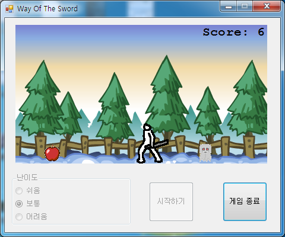

# Way of the Sword

양쪽에서 다가오는 사과, 바나나, 유령, 돌을 칼로 베어 점수를 모으는 액션 게임이다. 가운데 선 검객이 클릭한 쪽으로 칼을 휘두르고, 하나라도 몸에 닿으면 게임이 끝난다. 게임메이커의 오브젝트와 이벤트 구조를 VB.NET 클래스로 옮긴 작은 엔진 위에서 돌아간다. 학교 과제로 만들었다.

<p>
  
</p>


## 플레이 방법

Releases에서 받은 압축 파일에는 실행 파일과 배경음악 `BGM.mp3` 가 들어 있다. 둘을 같은 폴더에 두고 실행하면 되고, .NET Framework 4.5 와 Windows Media Player 가 있어야 한다.

난이도를 고르고 "시작하기" 를 누른다. 적은 화면 왼쪽이나 오른쪽 끝에서 무작위 속도로 나타나 반대편으로 지나간다. 게임 화면을 마우스 왼쪽 버튼으로 클릭하면 검객이 클릭한 쪽을 보고 칼을 휘두르고, 휘두르는 동안 칼에 닿은 적 하나가 사라지며 Score 가 1 오른다. 적이 검객 몸에 닿으면 게임이 끝나고 배경음악이 멈추며, 다시 난이도를 골라 시작할 수 있다.

| 난이도 | 적이 나오는 간격 |
|---|---|
| 쉬움 | 2초 |
| 보통 | 1초 |
| 어려움 | 0.5초 |


## 구현 원리

**게임메이커식 오브젝트 구조를 클래스로 만들었다.** `GmObject` 가 깊이(depth)별 `ArrayList` 배열에 인스턴스를 담고 `InstanceCreate`, `InstanceDestroy` 를 제공한다. 게임 오브젝트는 모두 `InstanceBase` 를 상속하는데, 기반 클래스가 인스턴스마다 타이머 두 개를 돌려 하나는 17ms 마다 속도와 방향으로 위치를 옮긴 뒤 `StepEvent` 를 부르고, 다른 하나는 `ImageSpeed` 에 맞춘 간격으로 애니메이션 프레임을 넘기다 마지막 프레임에서 `AnimationEndEvent` 를 부른다. 검객 `ObjCharacter` 와 적 `ObjMonster` 는 아래 이벤트를 재정의해 각자의 동작을 만든다.

```vb
Public Overridable Sub StepEvent()
End Sub

Public Overridable Sub AnimationEndEvent()
End Sub

Public Overridable Sub MouseGlobalPressedEvent(e As MouseEventArgs)
End Sub
```

**그리기는 버퍼 한 장에 모았다가 한 번에 올린다.** 17ms 마다 같은 배경 그림을 가로로 두 번 이어 그리고 Score 를 쓴 뒤 깊이 순서대로 모든 인스턴스를 버퍼 비트맵에 그리고, 다 그린 버퍼를 화면에 옮긴다. 왼쪽을 보는 검객은 그림을 복제해 `RotateFlip` 으로 좌우를 뒤집어 그린다.


## 파일

| 경로 | 내용 |
|---|---|
| `source/WayOfTheSword.sln` | Visual Studio 2013 솔루션 |
| `source/WayOfTheSword/GmObject.vb` | 인스턴스 관리, 그리기, 검객과 적 클래스 |
| `source/WayOfTheSword/frmMain.vb` | 시작, 난이도, 적 생성, 배경음악 |
| `source/WayOfTheSword/frmMain.Designer.vb`, `frmMain.resx` | 폼 디자인과 스프라이트 이미지 목록 |
| `source/WayOfTheSword/Resources/bgr.png` | 배경 |
| `docs/screenshots/` | 스크린샷 |
| Releases | 실행 파일과 배경음악 |


## 라이선스

CC BY-NC-ND 4.0 라이선스다. 출처를 밝히면 비상업 용도로 그대로 공유할 수 있고, 수정본 배포와 상업적 이용은 금지한다. 함께 들어 있는 것 중 다른 사람이 만든 라이브러리와 그림·소리·맵은 각자의 권리를 따른다. 자세한 내용은 [LICENSE](LICENSE) 에 있다.
